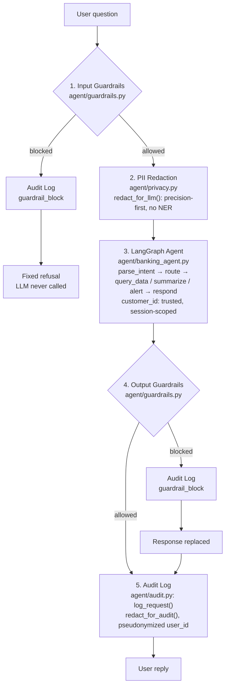
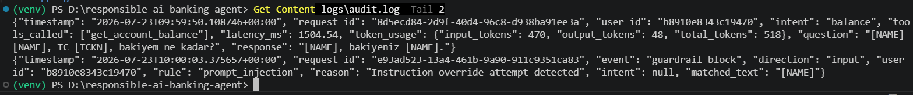
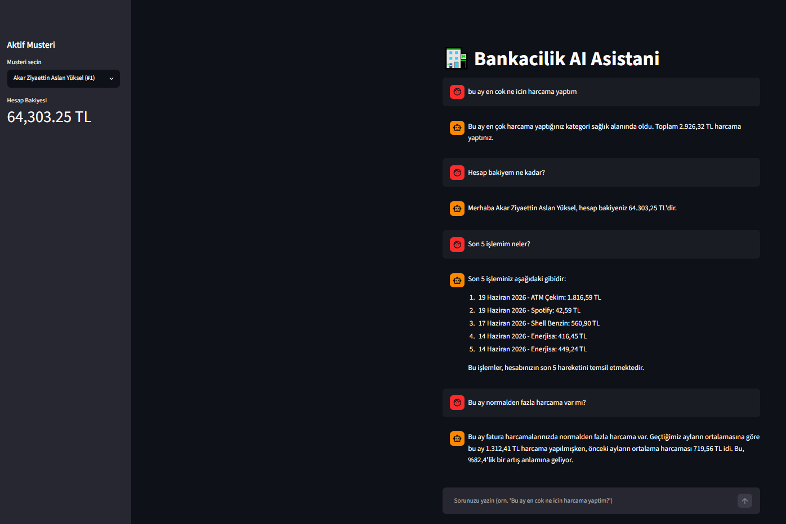

# Responsible AI Banking Agent

**Live demo (baseline agent, before the governance layer):** huggingface.co/spaces/Mervecaliskan/banking-ai-agent
**Türkçe:** [README.tr.md](README.tr.md)

> The deployed Space is older than the PII redaction, guardrails and audit logging in this repo, so it behaves differently.
> It accepts an identity typed into the chat. The current version ignores that and uses the trusted,
> session-scoped `customer_id` instead.

A conversational banking assistant, plus the governance layer it needs before it can be used in a regulated environment.

---

## Why this repo exists

**Starting point:** a working [LangGraph](https://www.langchain.com/langgraph) banking agent. It routes questions by
intent and answers them ("what's my balance?", "what did I spend the most on this month?") from synthetic account and
transaction data. It runs on `openai/gpt-oss-120b` on [Groq](https://groq.com/); it originally used
`llama-3.3-70b-versatile`, which Groq has since retired.

**The problem:** the agent worked, but a bank could not deploy it.
- **No PII protection:** a TC Kimlik No, IBAN or phone number typed into the chat went straight to the LLM and into the logs.
- **No guardrails:** nothing stopped prompt injection, requests for another customer's data, or investment advice.
- **No audit trail:** there was no record of what the agent decided or why.
- **No documentation** for a reviewer to check.

**What this repo adds:** PII redaction, input/output guardrails and structured audit logging around the original
agent, without changing its core logic. Tests and a model card document the results.

---

## Architecture: where governance sits in the request flow



Two design choices in this flow:

- **Redaction uses two different policies.** Text sent to the LLM uses a precision-first policy without NER, because a
  wrong redaction there could remove words the intent classifier needs. Text written to the audit log uses a
  recall-first policy with spaCy NER, because an extra redaction in a log does no harm, but a missed one is a
  compliance problem.
- **A blocked input never reaches the LLM.** Guardrails run before the first model call, so a prompt-injection
  attempt costs only a regex check.

The full reasoning, including known gaps, is in the [model card](docs/MODEL_CARD.md).

---

## Governance layer

| Component | What it does | Code |
|---|---|---|
| **PII redaction** | Microsoft Presidio with custom recognizers for Turkish TC Kimlik No (official checksum) and IBAN (ISO 7064 MOD97), plus a Turkish name heuristic with a stoplist. Precision-first policy for the LLM path, recall-first policy for the audit path. | [`agent/privacy.py`](agent/privacy.py) |
| **Guardrails** | Input: prompt injection, prompt/system extraction, customer_id manipulation, SQL-injection-like input. Output: financial or investment advice, cross-customer leakage, raw PII that survived redaction. Every block is logged. | [`agent/guardrails.py`](agent/guardrails.py) |
| **Audit logging** | One JSON line per request and per guardrail block: intent, tools called, latency, token usage, redacted question and response. `user_id` is pseudonymized with a salted hash and never stored raw. | [`agent/audit.py`](agent/audit.py) |
| **Model card** | System overview, intended and out-of-scope use, evaluation results and known limitations. | [`docs/MODEL_CARD.md`](docs/MODEL_CARD.md) |

---

## Results

Measured by the automated test suite ([`tests/`](tests/)):

| Check | Result |
|---|---|
| Adversarial prompts blocked | **25/25 (100%)**: prompt injection, prompt/system extraction, customer_id manipulation, SQL injection, financial advice, cross-customer leakage, raw PII leakage |
| Benign prompts allowed | **7/7 (0% false positives)** |
| Automated tests passing | **50/50** (32 for PII redaction, 18 for guardrails) |
| TCKN / IBAN detection | Real checksum algorithms (official Turkish ID checksum, ISO 7064 MOD97-10), not only pattern matching |

These numbers are a regression check on a curated adversarial set, not a security certification. The
[Known Limitations](docs/MODEL_CARD.md#known-limitations) section of the model card lists what they do not cover:
new phrasings, encoding tricks, multi-turn attacks and independent red-teaming.

---

## Evidence



Two real lines from `logs/audit.log`, produced by running the agent:

- **Normal request (top line):** a question with a name and a TC Kimlik No is logged with both redacted
  (`[NAME]`, `[TCKN]`) before anything is written to disk.
- **Blocked request (bottom line):** a prompt-injection attempt matches the `prompt_injection` rule and is logged as a
  `guardrail_block` event. `intent` is `null` because the block happens on input, before the LLM is called.
  `matched_text` is also redacted (`[NAME]`), so the security log itself does not leak PII.

---

## System overview

The agent classifies the intent of a question (`balance` / `transactions` / `spending` / `anomaly` / `general`),
routes it to a matching tool and turns the result into a reply:

| Question | Routes to |
|---|---|
| "What's my account balance?" | `query_data` (balance) |
| "What are my last 5 transactions?" | `query_data` (transactions) |
| "What did I spend the most on this month?" | `summarize` (spending) |
| "Is there more spending than usual this month?" | `alert` (anomaly) |

All data is synthetic. [`data/generate_data.py`](data/generate_data.py) creates 10 customers and about 550
transactions with `Faker('tr_TR')`, including one injected spending anomaly for the anomaly path to catch. No real
banking system or customer data is used.



---

## Project Structure

```
responsible-ai-banking-agent/
├── assets/
│   └── demo_screenshot.png  # Demo screenshot
├── data/
│   └── generate_data.py     # Synthetic customer/transaction generator
├── tools/
│   └── query_tools.py       # LangChain tools (SQLite + pandas)
├── agent/
│   ├── banking_agent.py     # LangGraph state machine
│   ├── audit.py             # Structured audit logging
│   ├── privacy.py           # PII detection & redaction (Presidio)
│   └── guardrails.py        # Input/output guardrails
├── tests/
│   ├── test_privacy.py      # 32 tests
│   └── test_guardrails.py   # 18 tests
├── docs/
│   └── MODEL_CARD.md        # System card: scope, evaluation, limitations
├── app.py                   # Streamlit chat interface
├── requirements.txt
└── .env.example
```

---

## Setup and Running

```bash
# 1. Virtual environment
python -m venv venv
source venv/Scripts/activate   # Windows: venv\Scripts\activate

# 2. Dependencies
pip install -r requirements.txt

# 3. Add your GROQ_API_KEY to the .env file
cp .env.example .env
# in .env: GROQ_API_KEY=gsk_...

# 4. Generate synthetic data
python data/generate_data.py

# 5. Start the app
streamlit run app.py

# Run the test suite
python -m pytest tests/ -v
```

---

## Tech Stack

- **LangGraph:** intent-based routing with a state machine
- **LangChain:** tool definitions
- **Groq (`openai/gpt-oss-120b`):** intent classification and reply generation
- **Microsoft Presidio + spaCy:** PII detection and redaction
- **SQLite + pandas:** synthetic data storage and queries
- **Streamlit:** chat interface
- **Faker:** synthetic Turkish data
- **pytest:** 50 automated tests

## Documentation

- [Model Card](docs/MODEL_CARD.md): scope, evaluation results, known limitations, risks and mitigations
- [README.tr.md](README.tr.md): Turkish version
