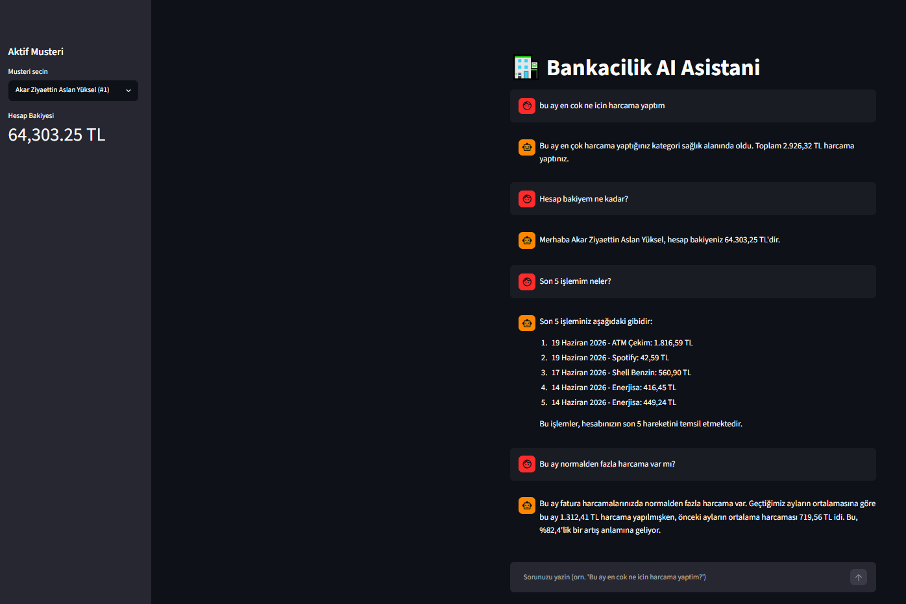
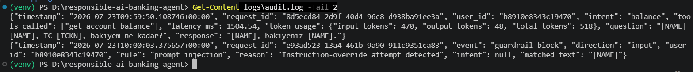

# Responsible AI Banking Agent

**Canlı demo (governance katmanından önceki ilk sürüm):** huggingface.co/spaces/Mervecaliskan/banking-ai-agent
**English:** [README.md](README.md)

> Yayındaki Space, bu repodaki PII maskeleme, guardrail ve audit logging katmanlarından önceki sürümdür. Bu yüzden
> farklı davranır: sohbete yazılan bir kimliği kabul eder. Güncel sürüm ise bunu yok sayar ve güvenilir,
> oturuma bağlı `customer_id` değerini kullanır.

[LangGraph](https://www.langchain.com/langgraph) ile kurulmuş, konuşma tabanlı bir bankacılık asistanı. Model olarak
[Groq](https://groq.com/) üzerinde `openai/gpt-oss-120b` kullanır; ilk sürüm, Groq'un artık kaldırdığı
`llama-3.3-70b-versatile` ile çalışıyordu. Gerçek müşteri verisi yerine sentetik hesap ve işlem kayıtları kullanır.
Kullanıcı doğal dilde soru sorar, agent soruyu SQL/pandas sorgularına çevirir ve Türkçe bir yanıt üretir.

> Governance katmanının (PII maskeleme, guardrail'ler, audit logging) mimari diyagramı ve ayrıntıları için
> İngilizce [README.md](README.md) dosyasına bakın.

## Amaç

"Bakiyem ne kadar?", "Bu ay en çok neye harcadım?", "Anormal bir harcama var mı?" gibi müşteri hizmetleri
sorularını, veritabanını sorgulayan ve soruyu niyetine göre yönlendiren bir agent ile yanıtlamayı gösteren bir demo
projesi. Gerçek banka altyapısı veya müşteri verisi içermez; tüm veriler `Faker` ile üretilir.

## Ekran Görüntüsü



## Mimari: LangGraph State Machine

Agent tek bir doğrusal zincir değil, soruyu **niyetine göre yönlendiren** bir graph olarak tasarlandı:

```
                 ┌───────────────┐
                 │  parse_intent  │   LLM soruyu sınıflandırır:
                 │                │   balance / transactions / spending /
                 └───────┬────────┘   anomaly / general + dönem/kategori
                         │
                  conditional routing
                  (niyete göre dallanma)
                         │
       ┌─────────────────┼──────────────────┐
       ▼                 ▼                  ▼
 ┌───────────┐    ┌─────────────┐    ┌───────────┐
 │ query_data │    │  summarize  │    │   alert    │
 │ (bakiye /  │    │ (harcama    │    │ (anomali   │
 │ işlem      │    │  analizi)   │    │  tespiti)  │
 │  listesi)  │    │             │    │            │
 └─────┬──────┘    └──────┬──────┘    └─────┬──────┘
       │                  │                 │
       └──────────────────┼─────────────────┘
                           ▼
                     ┌───────────┐
                     │  respond   │   LLM, sorgu sonucunu
                     │            │   Türkçe yanıta çevirir
                     └───────────┘
```

- **parse_intent:** `ChatGroq` (openai/gpt-oss-120b) kullanıcı mesajını JSON olarak sınıflandırır: niyet (`intent`),
  dönem (`period`: bu ay / geçen ay), kategori ve varsa işlem limiti.
- **conditional routing:** `add_conditional_edges` ile soru, niyetine göre doğrudan `query_data`, `summarize` veya
  `alert` düğümüne; genel sorularda ise `respond` düğümüne gider.
- **query_data:** Bakiye ve işlem listesi sorularında `get_account_balance` ve `get_transactions` tool'larını çalıştırır.
- **summarize:** Harcama sorularında `categorize_spending` ile kategori bazlı toplamları hesaplar.
- **alert:** "Anormal harcama var mı?" sorularında `detect_anomaly` ile bu ayın kategori harcamalarını önceki ayların
  ortalamasıyla karşılaştırır.
- **respond:** Sonucu LLM ile kısa bir Türkçe cümleye çevirir ve sohbet geçmişine ekler.

Kod: [`agent/banking_agent.py`](agent/banking_agent.py)

## Sentetik Veri

Gerçek banka verisi kullanılmadığı için [`data/generate_data.py`](data/generate_data.py), `Faker('tr_TR')` ile Türkçe
isimler kullanarak bir SQLite veritabanı (`data/banking.db`) üretir:

- **customers:** 10 müşteri (`customer_id, name, account_balance`)
- **transactions:** son 3 aya yayılmış 500'den fazla işlem, müşteri başına yaklaşık 55
  (`id, customer_id, date, amount, category, merchant, type`)
  - Kategoriler: `market, fatura, restoran, ulaşım, eğlence, sağlık, ATM`, ayrıca bakiye tutarlılığı için `maaş` geliri
  - Her kategori için örnek işyerleri (Migros, Türk Telekom, Netflix, Shell vb.)
  - **Bilinçli anomali:** bazı müşterilerde bu ay bir kategoride önceki aylara göre %80 ile %150 arası fazla harcama
    eklenir. Böylece "anormal harcama" sorusu gerçek bir durumla test edilebilir.

Script her çalıştığında tabloları silip yeniden oluşturur, yani tekrar tekrar çalıştırılabilir.

## Örnek Sorular

| Soru | Yönlendiği düğüm |
|---|---|
| "Hesap bakiyem ne kadar?" | `query_data` (balance) |
| "Son 5 işlemim neler?" | `query_data` (transactions) |
| "Bu ay en çok ne için harcama yaptım?" | `summarize` (spending) |
| "Geçen ay markete ne kadar harcadım?" | `summarize` (spending + kategori filtresi) |
| "Bu ay normalden fazla harcama var mı?" | `alert` (anomaly) |

## Governance Katmanı

- **Audit logging:** [`agent/audit.py`](agent/audit.py). Her istek ve her engelleme kararı için bir JSON satırı
  yazılır: niyet, çağrılan tool'lar, süre, token kullanımı, maskelenmiş soru ve yanıt.
- **PII maskeleme:** [`agent/privacy.py`](agent/privacy.py), Microsoft Presidio ile. TC Kimlik No ve IBAN için
  checksum doğrulamalı özel tanıyıcılar, isimler için stopword listesiyle filtrelenmiş bir kural eklendi. Metnin
  nereye gittiğine göre iki farklı politika uygulanır: LLM'e giden metinde precision öncelikli (NER'siz) maskeleme,
  audit log'a yazılan metinde recall öncelikli (spaCy NER eklenmiş) maskeleme. `user_id` loglarda ham haliyle değil,
  salted hash ile saklanır.
- **Guardrail'ler:** [`agent/guardrails.py`](agent/guardrails.py). Girdi tarafında prompt injection, sistem promptunu
  sızdırma girişimi, customer_id manipülasyonu ve SQL injection kalıpları; çıktı tarafında finansal/yatırım tavsiyesi,
  başka müşteriye ait veri ve maskelemeden kaçan ham PII engellenir. Her engelleme audit log'a yazılır.
- **Model card:** [`docs/MODEL_CARD.md`](docs/MODEL_CARD.md) (İngilizce). Kapsam, değerlendirme sonuçları ve bilinen
  kısıtlar (örneğin Türkçe için güvenilir bir NER modelinin olmaması) burada yazılı.

**Sonuçlar (50 otomatik test):** 25 saldırı isteminin 25'i engellendi (%100), 7 normal istemin 7'sine doğru şekilde
izin verildi (%0 yanlış pozitif). Bu sonuçlar seçilmiş bir test setine aittir, bir güvenlik sertifikası değildir.
Ayrıntılar için İngilizce [README.md](README.md#results) ve [model card](docs/MODEL_CARD.md).

## Kanıt



`logs/audit.log` dosyasından, agent çalıştırılarak elde edilmiş iki gerçek satır:

- **Normal istek (üst satır):** İsim ve TC Kimlik No içeren bir soru, diske yazılmadan önce ikisi de maskelenerek
  (`[NAME]`, `[TCKN]`) kaydedilir.
- **Engellenen istek (alt satır):** Bir prompt injection girişimi `prompt_injection` kuralına takılır ve
  `guardrail_block` olarak kaydedilir. `intent` alanı `null`, çünkü engelleme LLM çağrılmadan önce, girdi aşamasında
  olur. Kuralı tetikleyen ifade (`matched_text`) de maskelenmiştir (`[NAME]`), böylece güvenlik logunun kendisi PII
  sızdırmaz.

## Proje Yapısı

```
responsible-ai-banking-agent/
├── assets/
│   └── demo_screenshot.png  # Demo ekran görüntüsü
├── data/
│   └── generate_data.py     # Sentetik müşteri/işlem üretici
├── tools/
│   └── query_tools.py       # LangChain tool'ları (SQLite + pandas)
├── agent/
│   ├── banking_agent.py     # LangGraph state machine
│   ├── audit.py             # Yapılandırılmış audit logging
│   ├── privacy.py           # PII tespiti ve maskeleme (Presidio)
│   └── guardrails.py        # Girdi/çıktı guardrail katmanı
├── tests/
│   ├── test_privacy.py      # 32 test
│   └── test_guardrails.py   # 18 test
├── docs/
│   └── MODEL_CARD.md        # Sistem kartı (İngilizce)
├── app.py                   # Streamlit chat arayüzü
├── requirements.txt
└── .env.example
```

## Kurulum ve Çalıştırma

```bash
# 1. Sanal ortam
python -m venv venv
source venv/Scripts/activate   # Windows: venv\Scripts\activate

# 2. Bağımlılıklar
pip install -r requirements.txt

# 3. GROQ_API_KEY'i .env dosyasına ekle
cp .env.example .env
# .env içine: GROQ_API_KEY=gsk_...

# 4. Sentetik veriyi üret
python data/generate_data.py

# 5. Uygulamayı başlat
streamlit run app.py

# Testleri çalıştır
python -m pytest tests/ -v
```

## Kullanılan Teknolojiler

- **LangGraph:** niyete göre yönlendirme yapan state machine
- **LangChain:** tool tanımları
- **Groq (`openai/gpt-oss-120b`):** niyet sınıflandırma ve yanıt üretimi
- **Microsoft Presidio + spaCy:** PII tespiti ve maskeleme
- **SQLite + pandas:** sentetik veri saklama ve sorgulama
- **Streamlit:** chat arayüzü
- **Faker:** Türkçe sentetik veri
- **pytest:** 50 otomatik test
